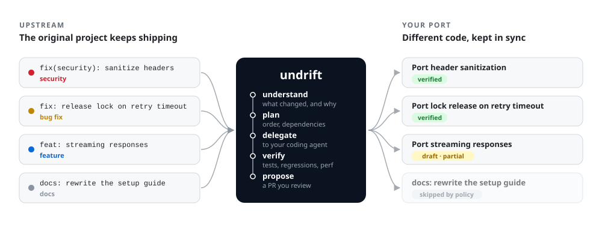

<div align="center">

# Undrift

**Different code. Same behavior.**

Keep your port, fork or SDK in sync with the project it came from,<br>
using the coding agent you already have.

[](https://github.com/aryehlev/undrift/actions/workflows/ci.yml)
[](go.mod)
[](LICENSE)

[The problem](#the-problem) · [How it works](#how-it-works) · [Quick start](#quick-start) · [Docs](docs/)

<br>

<picture>
  <source media="(prefers-color-scheme: dark)" srcset="docs/assets/hero-dark.svg">
  
</picture>

</div>

<br>

## The problem

Porting a project is a one-time cost. **Keeping it ported is not.**

The day you finish, your Rust rewrite of that Go service matches the
original. Then upstream keeps shipping: a security patch on Monday, two bug
fixes on Wednesday, a new feature on Friday. Each one has to be noticed,
understood, re-implemented in a different language and architecture, and
shown to be correct. Miss one, and your port quietly stops being the same
software.

The tools you'd usually reach for don't help:

- **`git merge` can't.** There's no shared code to merge.
- **Reading upstream's changelog doesn't scale.** It turns into a weekly chore that slips, and it usually slips first on the security fixes.
- **Pointing a coding agent at upstream** gets code written, but leaves the hard parts unsolved:
  - Which changes are already handled?
  - What did you deliberately skip, and why?
  - Which of your optimizations must not be undone?
  - Does the result actually behave like upstream?
  - Nothing remembers any of this for next week.

So ports drift. Slowly at first, then all at once.

## The idea

Undrift is the missing **merge for codebases that no longer share code.** It
synchronizes *behavior* rather than lines:

> Every upstream change becomes a tracked item in a ledger. Each one is
> understood, planned, implemented by your agent, **proven** by your own
> tests, and delivered as a pull request you review. A change only counts as
> synchronized once you merge it.

It's the same problem for many kinds of project:

| You maintain | Undrift keeps it current with |
|---|---|
| A port to another language | the original implementation |
| A heavily modified fork | its upstream |
| SDKs in several languages | the reference SDK |
| An alternative implementation of a protocol or spec | the reference implementation |
| A community edition, or an enterprise one | its counterpart |
| A system mid-migration | the old system's fixes, until cut-over |

## How it works

| | Step | What happens |
|---|---|---|
| 🔭 | **Watch** | Records every new upstream change: merged PRs, commits, reverts, releases. Each one gets a stable identity, so nothing is processed twice. A rewritten upstream history is detected and handled explicitly. |
| 🧠 | **Understand** | Classifies each change (security fix, bug fix, feature, refactor, …) with reasoning and a confidence score, and applies your policy. If Undrift isn't sure, it asks a human instead of skipping. |
| 🗺️ | **Map** | Finds where the affected behavior lives in *your* code, down to individual functions, across naming conventions and languages (`ParseHeader` ↔ `parse_header`). |
| 🧩 | **Plan** | Orders dependent changes and runs independent ones in parallel. Work stacks on unmerged dependencies, so one stuck change doesn't hold up the rest. |
| 🤖 | **Delegate** | Hands your agent a precise brief in an isolated worktree: the upstream diff, the relevant code on both sides, your architectural rules, past decisions, and what went wrong on earlier attempts. |
| ✅ | **Prove** | Re-runs *your* checks itself and never trusts the agent's word. That means build and tests, a new regression test that must fail before the change and pass after, an optional differential test against upstream, and performance budgets. |
| 📬 | **Propose** | Opens a pull request (or GitLab merge request) with the upstream links, what changed and why, how the port differs, and the verification table. Incomplete verification means a draft. |

## Why not just ask an agent?

Do ask an agent. Undrift is built around one. What it adds is everything
around the code:

| | Agent on its own | Agent driven by Undrift |
|---|:---:|:---:|
| Writes the code | ✅ | ✅ |
| Knows which upstream changes are already done | ❌ | ✅ ledger |
| Never duplicates work or PRs | ❌ | ✅ idempotent |
| Remembers what was skipped, and why | ❌ | ✅ decision history |
| Leaves your deliberate optimizations alone | 🤞 | ✅ recorded deviations |
| Proven with tests that fail before and pass after | 🤞 | ✅ independently verified |
| Survives crashes, timeouts and restarts | ❌ | ✅ leases and recovery |
| Treats upstream text as untrusted | 🤞 | ✅ fenced and sandboxed |
| Works with a different agent next month | ❌ | ✅ agent-agnostic |

## Quick start

```sh
go install github.com/aryehlev/undrift/cmd/undrift@latest
```

Run these inside your port's repository:

```sh
# 1. Point Undrift at upstream, and say which upstream version you match today.
undrift init --upstream https://github.com/org/project --baseline v1.4.0 \
             --verify "cargo build --locked" --verify "cargo test --locked"

# 2. Let it catch up. It finds, classifies, plans, implements, verifies and opens PRs.
export GITHUB_TOKEN=...          # or GITLAB_TOKEN
undrift run --agent claude       # or codex, gemini, opencode, or your own

# 3. See where things stand.
undrift status
```

To keep it running on a schedule, run `undrift integrations install github-actions`.

## Your agent, your infrastructure

**Agents.** Claude Code, Codex, Gemini CLI and OpenCode work out of the box.
Anything else that can edit a repository takes about four lines of YAML. You
can also flip the model around and let your own agent loop drive Undrift with
`next → claim → context → verify → complete`, or use the MCP server
(`undrift mcp`).

**Where it runs.** On your laptop, in GitHub Actions, GitLab CI, Jenkins, cron,
Kubernetes, or a Claude Code `/loop`. All of them share the same state.

**No lock-in.** There's no hosted service and no database. State is plain
files in your repository. Your project knowledge (mappings, deliberate
deviations, conventions) lives in reviewable YAML. On CI, the ledger rides
along on a git branch, and multi-machine workers coordinate through atomic
git refs.

## Built for trust

**🛡️ Upstream is untrusted.** Commit messages, PR text and diffs reach agents
only inside fenced blocks, and agents are told never to follow instructions
inside them. Upstream code is never executed unless you explicitly enable
differential testing.

**🔐 Least privilege.** Agents get a minimal environment; your tokens are
never forwarded by default. Each task runs in its own worktree with a
timeout, and you can wrap agents and checks in any sandbox
(`bwrap`, `firejail`, `docker run …`).

**🧑‍⚖️ You decide.** Low-confidence calls go to review, auto-merge is off by
default, and every decision is recorded with who made it and why.

```sh
undrift skip    a1b2c3 --reason "Not applicable to the Rust port"
undrift approve a1b2c3                     # overrides policy or a review hold
undrift deviations add --upstream internal/cache/lru.go --downstream src/cache.rs \
    --reason "Sharded lock-free map instead of a mutex-guarded LRU" --preserve "No global lock"
```

**💸 Bounded cost.** Every run is capped by changes per run, attempts per
change, timeouts and an optional dollar budget.

<details>
<summary><b>Command reference</b></summary>

| Command | Purpose |
|---|---|
| `init` | Create `undrift.yaml` and project memory |
| `scan` · `analyze` · `plan` | Discover, classify and plan upstream changes |
| `sync` · `run` · `watch` | Let an agent implement ready work (once, end to end, or continuously) |
| `next` · `claim` · `context` · `verify` · `complete` | External-agent workflow |
| `status` · `changes` · `inspect` · `history` · `report` | Visibility |
| `skip` · `approve` · `resolve` · `retry` | Human decisions |
| `mappings` · `deviations` · `notes` | Project memory |
| `state pull/push` · `reconcile` · `publish` | CI persistence and PR lifecycle |
| `integrations install` · `mcp` · `schema` | Integrations |

Every command accepts `--format json`. Exit codes: `0` ok · `3` nothing to do
· `4` verification failed · `5` leased by another worker · `6` needs review ·
`7` config error · `8` upstream history rewritten.

</details>

## Status

Undrift is an **early MVP**, usable and tested end to end. Today it has:

- pull requests on GitHub (including Enterprise) and GitLab (including self-managed);
- symbol-level analysis for 14 languages through Tree-sitter.

On the roadmap:

- language-server resolvers for references and types;
- Gitea, Forgejo and Bitbucket providers;
- richer differential-testing harnesses.

Issues and ideas are very welcome.

## Learn more

- [Configuration reference](docs/configuration.md) and an [annotated example](examples/undrift.yaml)
- [Agent task contract](docs/agent-contract.md): what agents receive and must return
- [Architecture](docs/architecture.md): ledger, lifecycle, concurrency, symbol analysis

<br>

<div align="center">
<sub>Apache 2.0 · Port once. Stay in sync.</sub>
</div>
